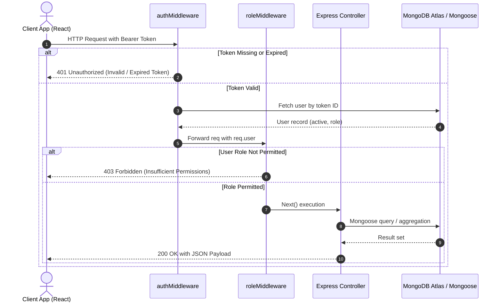

# Smart Hospital Management System — System Architecture & Design

## 1. Executive Summary & System Overview

The **Smart Hospital Management System** is an enterprise-grade, full-stack MERN (MongoDB, Express.js, React.js, Node.js) healthcare information platform designed to automate, digitize, and streamline all clinical, administrative, diagnostic, and pharmaceutical operations within a modern hospital.

The application enforces a **Single Shared Database Architecture** with exactly 11 logical Mongoose collections, governed by strict **Role-Based Access Control (RBAC)** across five distinct personas:
1. **Patient**: Personal health portal, intelligent doctor search, smart appointment booking, medical history, lab reports, and billing.
2. **Doctor**: Outpatient queue, clinical encounters, diagnostic test requests, and digital multi-item prescriptions.
3. **Laboratory**: Pathology/radiology request processing, test parameter entry, report generation, and diagnostic PDF uploads.
4. **Pharmacy**: Inventory lifecycle management, batch expiration tracking, stock replenishments, and prescription dispensing.
5. **Hospital Administrator**: System-wide governance, department structuring, medical staff onboarding, bed ward allocation, inpatient admissions/discharges, financial auditing, and real-time executive analytics.

---

## 2. High-Level Architecture Diagram

```mermaid
graph TD
    subgraph ClientLayer["Frontend Layer (React 18 + Vite)"]
        UI["Modern UI / UX (Lucide Icons + Tailwind-style CSS)"]
        Router["React Router v6 (Guarded & Role-Based Routes)"]
        State["Auth Context & Axios Interceptors"]
        Analytics["Recharts Visualizations (6 Executive Charts)"]
    end

    subgraph GatewayLayer["Application Gateway & Middleware"]
        CORS["CORS & Helmet Security Headers"]
        Limiter["Express Rate Limiting"]
        AuthMid["JWT Verification Middleware"]
        RoleMid["RBAC Role Authorization Middleware"]
        MulterMid["Multer File Upload Validator (MIME & Size)"]
    end

    subgraph ServiceLayer["Backend REST API (Node.js + Express)"]
        AuthCtrl["Auth & User Controller"]
        DeptCtrl["Department Controller"]
        ApptCtrl["Appointment & Slot Optimizer"]
        MedRecCtrl["Medical Record Controller"]
        RxCtrl["Prescription Controller"]
        MedCtrl["Medicine & Inventory Controller"]
        LabCtrl["Lab Report & PDF Controller"]
        BedCtrl["Bed & Ward Controller"]
        AdmCtrl["Admission & Discharge Controller"]
        BillCtrl["Billing & Payment Controller"]
        DashCtrl["Analytics & Aggregation Engine"]
    end

    subgraph DataLayer["Persistence Layer (MongoDB 7.0 / Mongoose 8)"]
        M01[("users")]
        M02[("departments")]
        M03[("appointments")]
        M04[("medicalRecords")]
        M05[("prescriptions")]
        M06[("medicines")]
        M07[("labReports")]
        M08[("beds")]
        M09[("admissions")]
        M10[("bills")]
        M11[("notifications")]
    end

    ClientLayer -->|HTTPS / REST + Bearer JWT| GatewayLayer
    GatewayLayer --> ServiceLayer
    ServiceLayer --> DataLayer
```

---

## 3. Core Architectural Principles

### 3.1 Strict Role-Based Access Control (RBAC)
Every incoming HTTP request to protected endpoints is intercepted by two layers of middleware:
- `authMiddleware.js`: Validates the signed JSON Web Token (JWT) from the `Authorization: Bearer <token>` header, decodes user credentials, and attaches the active `User` document to `req.user`.
- `roleMiddleware.js`: Verifies that `req.user.role` matches the permissible roles declared for the specific route (e.g., `roleMiddleware(['ADMIN', 'DOCTOR'])`). If unauthorized, it terminates the request with HTTP `403 Forbidden`.

### 3.2 Single Collection Entity Principle (Patients & Doctors in `users`)
In accordance with system specifications:
- No separate `patients` or `doctors` collections exist.
- All system actors are stored within the `users` collection.
- Doctors contain specialized profile fields (`specialization`, `department`, `licenseNumber`, `consultationFee`, `availableDays`, `timeSlots`, `experienceYears`, `education`).
- Patients contain specialized clinical demographics (`dateOfBirth`, `gender`, `bloodGroup`, `emergencyContact`, `medicalHistory`, `allergies`).
- All inter-collection references (`patientId`, `doctorId`, `prescribedBy`, `performedBy`, `issuedBy`, `requestedBy`) point directly to `User._id` using `ref: 'User'`.

---

## 4. Intelligent Smart Features & Algorithms

The system incorporates four proprietary algorithms to deliver proactive clinical and administrative automation:

### 4.1 Rule-Based Symptom Triage & Department Recommender
- **Location**: `backend/utils/departmentRecommender.js`
- **Functionality**: Takes patient-reported symptoms (natural language text or multi-select keywords) and applies normalized tokenization and weighted pattern matching against a dictionary of medical specialties:
  - *Cardiology*: chest pain, heart palpitations, shortness of breath, high blood pressure.
  - *Neurology*: headache, migraine, dizziness, numbness, seizure, fainting.
  - *Orthopedics*: joint pain, bone fracture, backache, arthritis, knee swelling.
  - *Dermatology*: skin rash, itching, acne, eczema, lesion, redness.
  - *Pediatrics*: child fever, infant cough, developmental milestones, vaccination.
  - *General Medicine*: mild fever, fatigue, weakness, common cold.
- **Safety Disclaimer**: The API enforces an explicit clinical disclaimer (`"Clinical Disclaimer: This automated recommendation is for triage guidance only and does not replace professional medical evaluation."`).

### 4.2 Dynamic Appointment Slot Optimizer & Double-Booking Guard
- **Location**: `backend/controllers/appointmentController.js`
- **Functionality**:
  1. Computes valid daily intervals based on doctor-specific `timeSlots` and `availableDays`.
  2. Queries existing bookings for `doctorId` on the target date.
  3. Filters out any slot where `status` is `'SCHEDULED'` or `'CONFIRMED'`.
  4. Enforces an atomic compound index constraint `(doctorId, appointmentDate, timeSlot)` to prevent concurrency race conditions during simultaneous booking attempts.

### 4.3 Predictive Medicine Low-Stock & Expiry Alert Engine
- **Location**: `backend/controllers/medicineController.js` & `dashboardController.js`
- **Functionality**:
  - Automatically flags inventory where `stock <= minStockLevel` as `LOW_STOCK` or `OUT_OF_STOCK`.
  - Scans `expiryDate` timestamps: flags items expiring within 30 days as `EXPIRING_SOON` and expired items as `EXPIRED`.
  - Generates actionable real-time inventory notifications to pharmacists and hospital administrators.

### 4.4 Hospital Bed Occupancy & Telemetry Engine
- **Location**: `backend/controllers/bedController.js` & `admissionController.js`
- **Functionality**:
  - Computes global and ward-specific occupancy metrics:
    $$\text{Occupancy Rate} = \left(\frac{\text{Occupied Beds}}{\text{Total Operational Beds}}\right) \times 100\%$$
  - Wards supported: `ICU`, `GENERAL`, `EMERGENCY`, `PEDIATRIC`, `MATERNITY`, `SURGICAL`.
  - Dynamic atomic status transitions:
    - Bed assignment on admission: `AVAILABLE -> OCCUPIED`
    - Bed release on discharge: `OCCUPIED -> MAINTENANCE/CLEANING -> AVAILABLE`

---

## 5. Security & Defensive Engineering

1. **Password Encryption**: All passwords undergo salted one-way hashing using `bcryptjs` with 10 salt rounds before storage in MongoDB.
2. **Stateless JWT Sessions**: JSON Web Tokens are signed using HMAC-SHA256 with an expiry duration of 30 days. No plaintext passwords or sensitive tokens are stored in local state unencrypted.
3. **HTTP Header Hardening**: Integrated `helmet` middleware sets defensive HTTP headers (`X-Content-Type-Options: nosniff`, `X-Frame-Options: SAMEORIGIN`, `Strict-Transport-Security`).
4. **Denial of Service Prevention**: `express-rate-limit` caps API ingestion at 1,000 requests per 15-minute window per IP address.
5. **Secure File Upload Pipeline**:
   - `uploadMiddleware.js` handles file uploads via `multer`.
   - Restricts file types to `application/pdf`, `image/jpeg`, `image/png`.
   - Imposes a strict 5 MB file size limit.
   - Generates cryptographically collision-resistant file names with sanitized extensions.

---

## 6. Frontend Architectural Pattern

- **Vite + React 18 SPA**: Zero-latency hot-module reloading and optimized tree-shaken production bundles.
- **Hierarchical Layout System**: All authenticated routes render inside `DashboardLayout.jsx`, featuring dynamic role-aware navigation sidebars, active notification badges, and user profile management.
- **Centralized Axios Interceptor**: `src/services/api.js` automatically injects `Authorization: Bearer <token>` into outbound requests and seamlessly intercepts HTTP `401 Unauthorized` responses to clear invalid sessions and redirect to login.
- **Responsive Dashboard Panels**: 24 dedicated pages engineered with modern CSS grid and flexbox, ensuring usability on desktop, tablet, and mobile devices.

---

## 7. Authentication & Portal Architecture

### 7.1 Unified Doctor Authentication Module
- **Component**: `frontend/src/components/auth/UnifiedDoctorAuth.jsx`
- **Consolidated Entrypoint**: Replaces fragmented doctor login mechanisms with a single, unified clinical gateway.
- **Multi-Doctor Credential Engine**:
  - Provides a 1-click physician roster selector pre-loaded with hospital specialists (Dr. Sarah Jenkins - Cardiology, Dr. Robert Chen - General Medicine, Dr. Emily Watson - Neurology).
  - Displays instant profile previews (Specialization badge, qualification, department, consultation fee, and years of clinical practice).
  - Also supports manual entry of any physician's credentials.
- **Dynamic Profile & Dashboard Binding**:
  - Upon authentication, validates `role === 'DOCTOR'`.
  - Dynamically customizes `DoctorDashboard.jsx` with the authenticated doctor's full profile banner, initials avatar, fee schedule, today's queue, and pending diagnostic orders.

### 7.2 Dedicated Patient Auth & Registration Flow
- **Component**: `frontend/src/components/auth/PatientAuthModal.jsx`
- **Dual-Mode Experience**: Can be invoked as an inline view in `Login.jsx` or as a standalone modal across the application.
- **Clean Styled Action Switch**:
  - Segmented pill switch controls between `[ Sign In (Registered Patient) ]` and `[ Create Account (New Patient) ]`.
  - When in Sign In mode, includes a styled outlined action button: `"New Patient? Register / Sign Up for Care →"`.
  - When in Register mode, includes a styled outlined action button: `"Already registered? Click here to Sign In ←"`.
- **Inline Demographics Capture**: Collects full medical demographics (Blood group, gender, DOB, address, phone) and automatically logs the patient in upon registration.

### 7.3 Visual Design System & Background Overlays
- **Medical Tech Backgrounds**:
  - `.medical-tech-bg`: Deep slate background (`#0b132b`) with dual radial mesh gradients in clinical blue (`#2563eb`) and teal (`#0d9488`), complemented by an SVG medical grid overlay.
  - `.medical-tech-light-bg`: Ambient light theme overlay for authenticated dashboard workspaces (`DashboardLayout.jsx`).
- **Glassmorphic Cards**:
  - `.auth-glass-container`: Frosted glass finish (`backdrop-filter: blur(16px)`), crisp hairline borders, and multi-tier elevation shadows.
- **Micro-Interactions**:
  - Smooth transitions on input focus rings, doctor selection cards, and styled switch button states.
