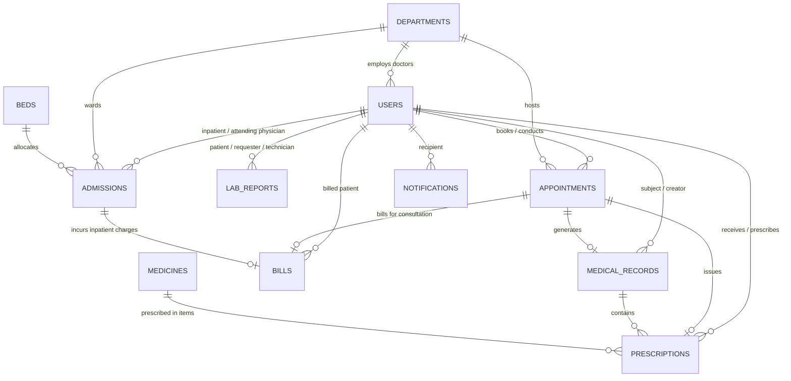

# Smart Hospital Management System — Database Schema Specification

## 1. Schema Overview

The Smart Hospital database utilizes **MongoDB** via the **Mongoose ODM**. The database structure strictly adheres to the non-negotiable requirement of maintaining **exactly 11 logical collections**, with **no separate collections** for `patients`, `doctors`, or `labRequests`.

---

## 2. Detailed Schema Definitions

### 2.1 Collection: `users`
Stores all hospital personnel and patients. Clinical and professional attributes are conditionally populated according to the user's `role`.

| Field | Type | Required | Constraints / Defaults | Description |
| :--- | :--- | :--- | :--- | :--- |
| `_id` | ObjectId | Auto | Primary Key | Unique user identifier |
| `name` | String | Yes | Trimmed, 2-100 chars | Full legal name |
| `email` | String | Yes | Unique, Lowercase, Indexed | User login email |
| `password` | String | Yes | Min 6 chars (bcrypt hashed) | Salted password hash |
| `role` | String | Yes | Enum: `PATIENT`, `DOCTOR`, `LAB`, `PHARMACY`, `ADMIN` | Role defining system permissions |
| `phone` | String | No | Trimmed | Contact telephone number |
| `address` | Object | No | `{ street, city, state, zipCode }` | Residential/office address |
| `avatar` | String | No | Default: generic avatar URL | Profile image path |
| `isActive` | Boolean | Yes | Default: `true` | Account active state |
| **Patient Demographics** | | | *(Populated for PATIENT)* | |
| `dateOfBirth` | Date | No | ISO Date | Patient birth date |
| `gender` | String | No | Enum: `MALE`, `FEMALE`, `OTHER` | Gender identity |
| `bloodGroup` | String | No | Enum: `A+`, `A-`, `B+`, `B-`, `AB+`, `AB-`, `O+`, `O-` | Blood group |
| `emergencyContact` | Object | No | `{ name, relationship, phone }` | Next of kin contact info |
| `allergies` | [String] | No | Array of strings | Known drug/food allergies |
| `medicalHistory` | [String] | No | Array of strings | Pre-existing medical conditions |
| **Doctor Credentials** | | | *(Populated for DOCTOR)* | |
| `specialization` | String | No | Trimmed | Medical specialty (e.g. Cardiologist) |
| `department` | ObjectId | No | Ref: `Department` | Associated clinical department |
| `licenseNumber` | String | No | Unique (sparse) | Medical council license number |
| `consultationFee` | Number | No | Min: 0, Default: 50 | Outpatient consultation fee ($) |
| `experienceYears` | Number | No | Min: 0 | Years of active clinical practice |
| `education` | [String] | No | Array of strings | Degrees & certifications (MD, MBBS) |
| `availableDays` | [String] | No | Enum: Mon, Tue, Wed, Thu, Fri, Sat, Sun | Weekly working days |
| `timeSlots` | [String] | No | E.g. `['09:00 AM', '10:00 AM']` | Standard consultation slots |

---

### 2.2 Collection: `departments`
Hospital clinical and administrative divisions.

| Field | Type | Required | Constraints / Defaults | Description |
| :--- | :--- | :--- | :--- | :--- |
| `_id` | ObjectId | Auto | Primary Key | Department identifier |
| `name` | String | Yes | Unique, Trimmed | E.g. Cardiology, Neurology |
| `code` | String | Yes | Unique, Uppercase | E.g. `CARD`, `NEUR`, `ORTH` |
| `description` | String | No | Text | Department clinical scope |
| `headOfDepartment` | ObjectId | No | Ref: `User` (Role: DOCTOR) | Department lead physician |
| `phone` | String | No | Trimmed | Department contact extension |
| `email` | String | No | Email format | Department inquiry email |
| `location` | String | No | Building/Floor info | Physical ward/wing location |
| `status` | String | Yes | Enum: `ACTIVE`, `INACTIVE` (Default: `ACTIVE`) | Operational status |

---

### 2.3 Collection: `appointments`
Outpatient visits, schedule coordination, and slot allocations.

| Field | Type | Required | Constraints / Defaults | Description |
| :--- | :--- | :--- | :--- | :--- |
| `_id` | ObjectId | Auto | Primary Key | Appointment identifier |
| `patientId` | ObjectId | Yes | Ref: `User` (Indexed) | Patient receiving care |
| `doctorId` | ObjectId | Yes | Ref: `User` (Indexed) | Assigned doctor |
| `departmentId` | ObjectId | No | Ref: `Department` | Clinical department |
| `appointmentDate` | Date | Yes | ISO Date (Indexed) | Date of scheduled consultation |
| `timeSlot` | String | Yes | E.g. `09:30 AM` | Reserved time slot |
| `status` | String | Yes | Enum: `SCHEDULED`, `CONFIRMED`, `IN_PROGRESS`, `COMPLETED`, `CANCELLED` | Lifecycle state |
| `type` | String | Yes | Enum: `GENERAL`, `FOLLOW_UP`, `EMERGENCY`, `ROUTINE` | Nature of visit |
| `reason` | String | Yes | Max 500 chars | Primary symptom/complaint |
| `symptoms` | [String] | No | Array of strings | Structured symptom tags |
| `notes` | String | No | Text | Clinical or administrative notes |
| `vitals` | Object | No | `{ bloodPressure, temperature, pulse, respiratoryRate, weight }` | Pre-consultation vitals |

*Compound Index:* `{ doctorId: 1, appointmentDate: 1, timeSlot: 1 }` prevents double-booking.

---

### 2.4 Collection: `medicalRecords`
Longitudinal electronic health records (EHR) created during patient encounters.

| Field | Type | Required | Constraints / Defaults | Description |
| :--- | :--- | :--- | :--- | :--- |
| `_id` | ObjectId | Auto | Primary Key | Medical record ID |
| `recordNumber` | String | Yes | Unique, Auto-generated | E.g. `MR-2026-0001` |
| `patientId` | ObjectId | Yes | Ref: `User` (Indexed) | Patient reference |
| `doctorId` | ObjectId | Yes | Ref: `User` (Indexed) | Attending physician |
| `appointmentId` | ObjectId | No | Ref: `Appointment` | Associated consultation |
| `visitDate` | Date | Yes | Default: `Date.now` | Date of clinical visit |
| `diagnosis` | String | Yes | Text | Formal ICD / Clinical diagnosis |
| `symptoms` | [String] | Yes | Array of strings | Presenting symptoms |
| `clinicalNotes` | String | Yes | Detailed Markdown/Text | Doctor's objective observations |
| `treatmentPlan` | String | Yes | Text | Recommended medical care |
| `vitalSigns` | Object | No | `{ bloodPressure, heartRate, temperature, oxygenSaturation, bmi }` | Recorded physiological stats |
| `followUpDate` | Date | No | ISO Date | Recommended review appointment |
| `attachments` | [Object] | No | `[{ name, fileUrl, uploadedAt }]` | Scanned discharge/external documents |

---

### 2.5 Collection: `prescriptions`
Digital prescriptions containing multi-item medication orders.

| Field | Type | Required | Constraints / Defaults | Description |
| :--- | :--- | :--- | :--- | :--- |
| `_id` | ObjectId | Auto | Primary Key | Prescription ID |
| `prescriptionNumber`| String | Yes | Unique, Auto-generated | E.g. `RX-2026-0001` |
| `patientId` | ObjectId | Yes | Ref: `User` (Indexed) | Target patient |
| `doctorId` | ObjectId | Yes | Ref: `User` (Indexed) | Prescribing physician |
| `appointmentId` | ObjectId | No | Ref: `Appointment` | Associated encounter |
| `medicalRecordId`| ObjectId | No | Ref: `MedicalRecord` | Linked clinical record |
| `diagnosis` | String | Yes | Text | Reason for pharmacotherapy |
| `medicines` | [Object] | Yes | Array of prescribed drugs | Items to dispense |
| ↳ `medicineId` | ObjectId | Yes | Ref: `Medicine` | Target drug in inventory |
| ↳ `medicineName` | String | Yes | Text | Human-readable trade name |
| ↳ `dosage` | String | Yes | E.g. `500 mg` | Active dose per ingestion |
| ↳ `frequency` | String | Yes | E.g. `TID (Three times daily)` | Daily timing |
| ↳ `duration` | String | Yes | E.g. `7 days` | Treatment timeframe |
| ↳ `instructions` | String | No | E.g. `Take after meals` | Administration guidelines |
| ↳ `quantity` | Number | Yes | Min: 1 | Total units prescribed |
| ↳ `dispensed` | Boolean | Yes | Default: `false` | Pharmacist fulfillment flag |
| `status` | String | Yes | Enum: `ACTIVE`, `DISPENSED`, `PARTIAL`, `CANCELLED` | Order fulfillment status |
| `validUntil` | Date | Yes | Default: +30 days | Prescription expiry date |

---

### 2.6 Collection: `medicines`
Pharmacy formulary and inventory tracking.

| Field | Type | Required | Constraints / Defaults | Description |
| :--- | :--- | :--- | :--- | :--- |
| `_id` | ObjectId | Auto | Primary Key | Medicine item ID |
| `name` | String | Yes | Unique, Trimmed | Commercial/Brand name |
| `genericName` | String | Yes | Trimmed | Pharmacological generic name |
| `category` | String | Yes | Enum: `ANTIBIOTIC`, `ANALGESIC`, `ANTIPYRETIC`, `ANTIDIABETIC`, `ANTIHYPERTENSIVE`, `ANTIVIRAL`, `OTHER` | Drug therapeutic classification |
| `manufacturer` | String | Yes | Trimmed | Pharmaceutical company |
| `batchNumber` | String | Yes | Trimmed | Production batch ID |
| `unitPrice` | Number | Yes | Min: 0 | Retail price per unit ($) |
| `stock` | Number | Yes | Min: 0, Default: 0 | Current shelf quantity |
| `minStockLevel` | Number | Yes | Default: 20 | Minimum alert reorder threshold |
| `expiryDate` | Date | Yes | ISO Date (Indexed) | Batch shelf-life expiration |
| `dosageForm` | String | Yes | Enum: `TABLET`, `CAPSULE`, `SYRUP`, `INJECTION`, `OINTMENT`, `DROPS` | Physical form |
| `strength` | String | Yes | E.g. `500mg`, `10mg/ml` | Active pharmaceutical strength |
| `status` | String | Yes | Enum: `AVAILABLE`, `LOW_STOCK`, `OUT_OF_STOCK`, `EXPIRED` | Computed inventory state |

---

### 2.7 Collection: `labReports`
Manages the entire diagnostic laboratory lifecycle (requests, processing, and verified results).

| Field | Type | Required | Constraints / Defaults | Description |
| :--- | :--- | :--- | :--- | :--- |
| `_id` | ObjectId | Auto | Primary Key | Diagnostic test ID |
| `reportNumber` | String | Yes | Unique, Auto-generated | E.g. `LAB-2026-0001` |
| `testName` | String | Yes | E.g. `Complete Blood Count (CBC)`| Standard test name |
| `category` | String | Yes | Enum: `PATHOLOGY`, `RADIOLOGY`, `BIOCHEMISTRY`, `MICROBIOLOGY`, `HEMATOLOGY` | Diagnostic specialty |
| `patientId` | ObjectId | Yes | Ref: `User` (Indexed) | Patient specimen owner |
| `requestedBy` | ObjectId | Yes | Ref: `User` (Indexed) | Ordering physician |
| `performedBy` | ObjectId | No | Ref: `User` | Laboratory technician |
| `status` | String | Yes | Enum: `REQUESTED`, `SAMPLE_COLLECTED`, `IN_PROGRESS`, `COMPLETED`, `CANCELLED` | Order lifecycle |
| `sampleCollectedAt`| Date | No | ISO Date | Timestamp of sample drawing |
| `specimenType` | String | No | E.g. `Venous Blood`, `Urine` | Specimen type |
| `results` | [Object] | No | Array of metric readings | Structured biomarkers |
| ↳ `parameter` | String | Yes | E.g. `Hemoglobin` | Analyte name |
| ↳ `value` | String | Yes | E.g. `14.2` | Observed test measurement |
| ↳ `unit` | String | Yes | E.g. `g/dL` | Unit of measure |
| ↳ `referenceRange`| String | Yes | E.g. `13.5 - 17.5` | Standard healthy range |
| ↳ `status` | String | Yes | Enum: `NORMAL`, `HIGH`, `LOW`, `CRITICAL` | Metric status |
| `conclusion` | String | No | Clinical interpretation | Pathologist's summary report |
| `attachmentUrl` | String | No | File path to PDF report | Uploaded diagnostic document |
| `isUrgent` | Boolean | Yes | Default: `false` | STAT / Emergency priority |

---

### 2.8 Collection: `beds`
Hospital inpatient capacity and telemetry.

| Field | Type | Required | Constraints / Defaults | Description |
| :--- | :--- | :--- | :--- | :--- |
| `_id` | ObjectId | Auto | Primary Key | Bed identifier |
| `bedNumber` | String | Yes | Unique, Uppercase | E.g. `ICU-101`, `GEN-204` |
| `ward` | String | Yes | Enum: `ICU`, `GENERAL`, `EMERGENCY`, `PEDIATRIC`, `MATERNITY`, `SURGICAL` | Physical ward assignment |
| `type` | String | Yes | Enum: `STANDARD`, `ICU`, `VENTILATOR`, `PEDIATRIC`, `PRIVATE` | Bed functional tier |
| `floor` | Number | Yes | Min: 0 | Building floor level |
| `dailyRate` | Number | Yes | Min: 0 | Daily admission charge ($) |
| `status` | String | Yes | Enum: `AVAILABLE`, `OCCUPIED`, `MAINTENANCE`, `RESERVED` | Telemetry occupancy state |
| `currentPatientId`| ObjectId | No | Ref: `User` | Patient currently occupying bed |
| `features` | [String] | No | E.g. `['Ventilator', 'Cardiac Monitor']`| Clinical equipment |

---

### 2.9 Collection: `admissions`
Inpatient admissions, continuous care management, and discharges.

| Field | Type | Required | Constraints / Defaults | Description |
| :--- | :--- | :--- | :--- | :--- |
| `_id` | ObjectId | Auto | Primary Key | Admission identifier |
| `admissionNumber` | String | Yes | Unique, Auto-generated | E.g. `ADM-2026-0001` |
| `patientId` | ObjectId | Yes | Ref: `User` (Indexed) | Admitted patient |
| `bedId` | ObjectId | Yes | Ref: `Bed` (Indexed) | Allocated bed resource |
| `attendingDoctorId`| ObjectId | Yes | Ref: `User` (Indexed) | Primary inpatient physician |
| `departmentId` | ObjectId | No | Ref: `Department` | Clinical specialty ward |
| `admissionDate` | Date | Yes | Default: `Date.now` | Inpatient intake timestamp |
| `dischargeDate` | Date | No | ISO Date | Formal discharge timestamp |
| `status` | String | Yes | Enum: `ADMITTED`, `DISCHARGED`, `TRANSFERRED` | Inpatient care status |
| `reasonForAdmission`| String | Yes | Text | Clinical reason for inpatient care |
| `diagnosis` | String | No | Text | Preliminary admission diagnosis |
| `notes` | String | No | Text | Daily clinical ward progress notes |
| `emergencyContact` | Object | No | `{ name, relationship, phone }` | Active emergency contact info |

---

### 2.10 Collection: `bills`
Unified financial accounting across consultations, pharmacy, diagnostic tests, and inpatient bed occupancy.

| Field | Type | Required | Constraints / Defaults | Description |
| :--- | :--- | :--- | :--- | :--- |
| `_id` | ObjectId | Auto | Primary Key | Bill ID |
| `billNumber` | String | Yes | Unique, Auto-generated | E.g. `INV-2026-0001` |
| `patientId` | ObjectId | Yes | Ref: `User` (Indexed) | Debtor patient |
| `admissionId` | ObjectId | No | Ref: `Admission` | Associated hospital stay |
| `appointmentId` | ObjectId | No | Ref: `Appointment` | Associated clinic visit |
| `items` | [Object] | Yes | Array of line charges | Detailed itemized breakdown |
| ↳ `description` | String | Yes | E.g. `Consultation Fee - Cardiology`| Item description |
| ↳ `category` | String | Yes | Enum: `CONSULTATION`, `MEDICINE`, `LAB_TEST`, `BED_CHARGE`, `PROCEDURE`, `OTHER` | Cost center |
| ↳ `quantity` | Number | Yes | Min: 1, Default: 1 | Billed count |
| ↳ `unitPrice` | Number | Yes | Min: 0 | Price per unit ($) |
| ↳ `total` | Number | Yes | Computed (`quantity * unitPrice`) | Total item amount |
| `subtotal` | Number | Yes | Min: 0 | Sum of line items |
| `discount` | Number | Yes | Default: 0 | Applied discount ($) |
| `tax` | Number | Yes | Default: 0 | Applied municipal/sales tax ($) |
| `totalAmount` | Number | Yes | Computed (`subtotal - discount + tax`) | Final payable balance ($) |
| `paidAmount` | Number | Yes | Default: 0 | Amount received to date |
| `paymentStatus` | String | Yes | Enum: `PAID`, `PARTIAL`, `UNPAID` | Payment clearance state |
| `paymentMethod` | String | No | Enum: `CASH`, `CREDIT_CARD`, `INSURANCE`, `ONLINE` | Payment instrument |
| `paymentDate` | Date | No | ISO Date | Timestamp of latest payment |
| `notes` | String | No | Text | Financial notes / Insurance claim ID |

---

### 2.11 Collection: `notifications`
Real-time push alerts, clinical task reminders, and system events.

| Field | Type | Required | Constraints / Defaults | Description |
| :--- | :--- | :--- | :--- | :--- |
| `_id` | ObjectId | Auto | Primary Key | Notification ID |
| `user` | ObjectId | Yes | Ref: `User` (Indexed) | Target recipient user |
| `title` | String | Yes | Trimmed, Max 100 chars | Notification headline |
| `message` | String | Yes | Trimmed, Max 500 chars | Detailed notification text |
| `type` | String | Yes | Enum: `APPOINTMENT`, `LAB`, `PRESCRIPTION`, `PHARMACY`, `BILL`, `ADMISSION`, `SYSTEM` | Category of alert |
| `link` | String | No | E.g. `/patient/appointments` | In-app navigational target |
| `isRead` | Boolean | Yes | Default: `false` (Indexed) | Read acknowledgement status |
| `createdAt` | Date | Yes | Default: `Date.now` | Event timestamp |
